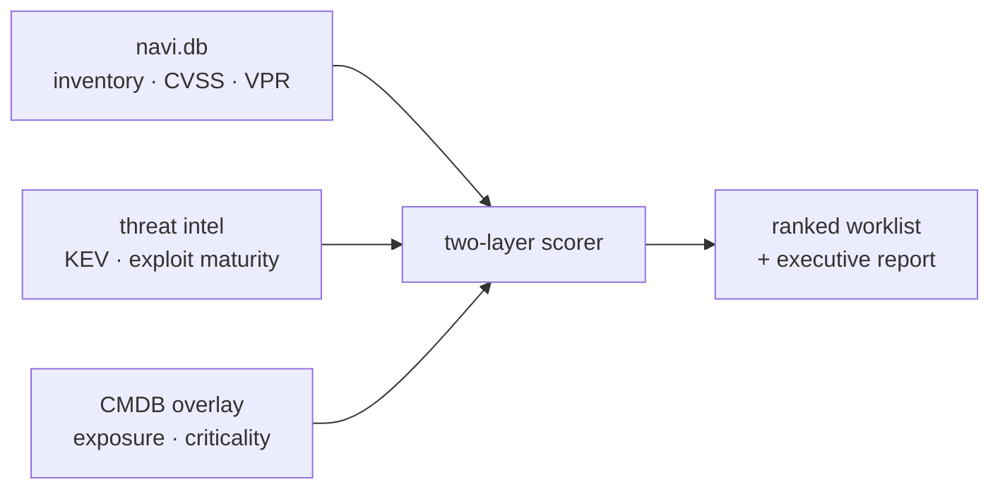

<h1 align="center">vuln-prioritizer</h1>
<p align="center"><b>Deterministic, context-aware vulnerability prioritization.</b></p>
<p align="center">
Turns a scanner dump into a ranked, evidence-backed remediation worklist — with defensible SLAs,
real threat intelligence, and no guessing.
</p>

<p align="center">
<a href="DOCS.md">Documentation</a> ·
<a href="#quickstart">Quickstart</a> ·
<a href="DOCS.md#cli-reference">CLI</a> ·
<a href="DOCS.md#the-ai-classifier">AI layer</a>
</p>

<p align="center">


<a href="https://exchange.tenable.com/"></a>
</p>

---

`vuln-prioritizer` fuses **ground-truth inventory**, **live exploit intelligence**, and **asset context**
into a two-layer model, and produces a worklist where every item carries its evidence, its tier, and its
due date and where the same inputs always produce the same answer.



On a live run against the reference tenant (**20,522 findings / 1,394 assets**):

| 20,522 findings / 1,394 assets | Result |
|---|---|
| **Tier 0 - emergencies** · internet-exposed + actively exploited (~12h) | **25** |
| Tier 1 - due within 24h | **161** |
| Ranked remediation worklist (all tiers) | **11,123** |
| Informational scanner findings separated out | **9,399** |
| Actively-exploited vulns the vendor rated *Low*, lifted by KEV/exploit evidence | **9** |
| Time to worklist | **6.2 s** live (incl. feed fetch) · sub-second offline, byte-reproducible |

## Quickstart

```bash
pip install -e .

# No tenant, no API key: build the 100% synthetic fixture and run the whole
# scored pipeline offline, then replay it byte-for-byte to prove determinism.
bash scripts/demo.sh

# Against your own data: point --db at a navi.db exported by navi (read-only).
vuln-prioritizer run --db ~/navi.db --overlay classification.example.yaml --out out --offline

# Live, key-free threat intel (CISA KEV + exploit maturity), cached and replayable.
vuln-prioritizer run --db ~/navi.db --overlay classification.example.yaml --out out \
  --intel-cache out/intel.json
```

Inventory comes from [navi](https://github.com/packetchaos/navi) (Tenable → local SQLite). Outputs land in
`out/`: `worklist.md` / `.csv`, `executive_report.md`, plus `informational.csv` and `excluded.csv`.

A worklist row explains itself:

> **Tier 0 · Emergency ~12h / out-of-band** - `fw-edge-01` (perimeter_firewall) · CVE-2026-109618
> *Evidence:* CVE-2026-109618: on CISA KEV since 2026-10-26; Exploit-DB 1 entry; Nuclei template
> *Inputs:* impact CRITICAL [cvss_unattributed 9.8] x probability CRITICAL [vpr 9.5] -> T1; asset class externally_exposed (shift +1, applied +1) -> T0; env production[overlay], exposure external[overlay], criticality standard[overlay_default]; overlay rule 3 (perimeter_firewall)

## Why deterministic

Every tier is a reproducible function of recorded inputs - CVSS, VPR, EPSS, CISA KEV, exploit maturity,
asset context. Same inputs, same answer, byte for byte, including live enriched runs replayed from a
frozen cache. An LLM may *propose* asset classifications, but it is **firewalled from scoring**, cannot
set `external` or `crown_jewel`, and abstains rather than fabricate.

- **Read-only** - never writes to your tenant. Verified by test.
- **Auditable** - every tier records the inputs and sources that produced it.
- **Honest about gaps** - flags what needs a human instead of guessing.

**→ [Full documentation](DOCS.md)** - the scoring model, asset-context overlays, enrichment modes,
the AI classifier, CLI reference, and limitations.

## Built on

[navi](https://github.com/packetchaos/navi) for Tenable inventory ·
[threat-intel-toolkit](https://github.com/kevinmhorvath/threat-intel-toolkit) for key-free exploit
intelligence. Both MIT, both on the Tenable CyberAgents Exchange.
## Install as a Claude Code plugin

```
/plugin marketplace add alkaf499/vuln_prioritizer
/plugin install vuln-prioritizer@vuln-prioritizer-marketplace
```

This installs the `vuln-prioritizer` skill. The `vuln-prioritizer` command itself still comes from
`pip install -e .` (see [Quickstart](#quickstart)).

## License

MIT — see [LICENSE](LICENSE). Upstream feeds and tools remain under their own licenses.
